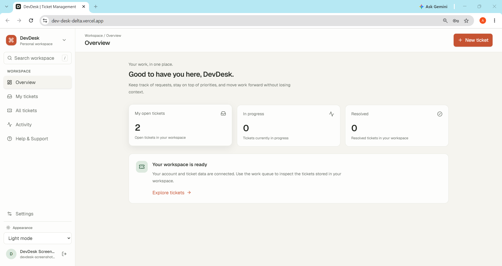
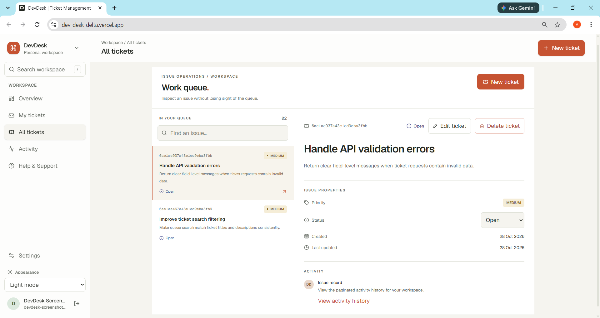
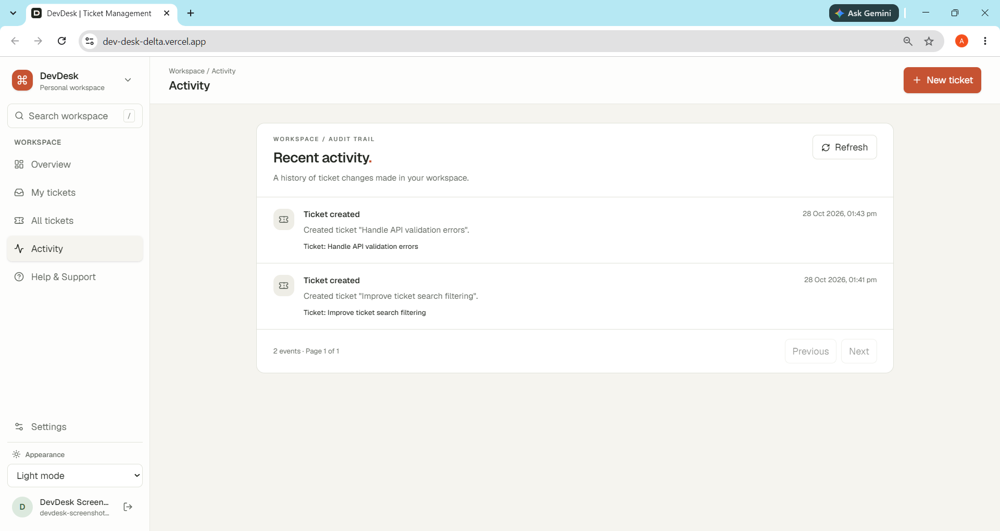
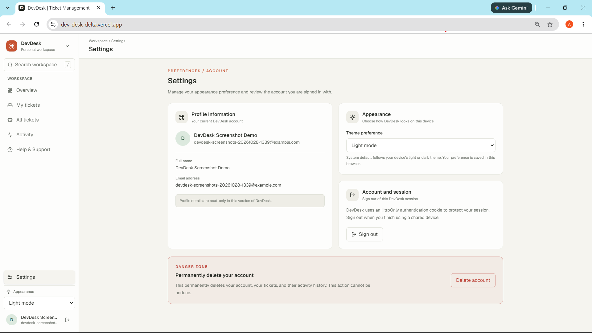
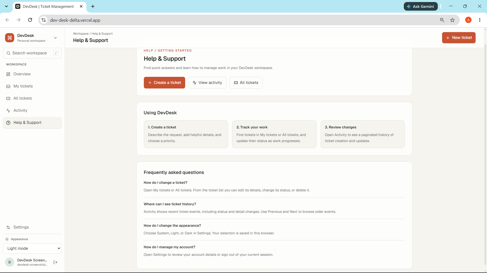

# DevDesk

**A full-stack workspace for creating, organizing, and tracking support tickets.**

[Live application](https://dev-desk-delta.vercel.app/) · [Backend API](https://devdesk-api.onrender.com/) · [GitHub repository](https://github.com/amarpraharaj/DevDesk)

## Table of contents

- [Overview](#overview)
- [Features](#features)
- [Technology stack](#technology-stack)
- [Screenshots](#screenshots)
- [Architecture](#architecture)
- [Run locally](#run-locally)
- [Environment variables](#environment-variables)
- [API reference](#api-reference)
- [Testing](#testing)
- [Deployment](#deployment)
- [Security notes](#security-notes)
- [Limitations and future work](#limitations-and-future-work)
- [Contributing](#contributing)

## Overview

DevDesk is a full-stack ticket management workspace. Users can create and manage their own tickets, track status and priority, search their queue, and review a chronological activity history. The application includes account registration and login, password recovery, a browser-persisted theme preference, and account deletion.

The frontend is a React single-page application. Its API is an Express service backed by MongoDB and is configured for the deployed Vercel frontend and Render backend linked above.

## Features

- **Authentication:** Register, log in, check the current session, and log out.
- **Password recovery:** Request a reset email and set a new password with a time-limited reset token.
- **Ticket management:** Create, view, update, and delete tickets. Each ticket has a title, description, priority (`low`, `medium`, `high`), and status (`open`, `in-progress`, `resolved`, `closed`).
- **Search and filtering:** Search tickets and filter the queue by status or priority; the API also supports pagination and sorting. “All tickets” lists all tickets belonging to the currently signed-in user; it is not a global or admin view.
- **Activity History:** Review paginated ticket creation, update, status-change, and deletion events.
- **Settings:** View account details, choose System/Light/Dark appearance, sign out, or delete the account. Theme preference is saved in the current browser.
- **Help & Support:** In-app getting-started guidance and FAQs, with shortcuts to tickets and activity history.
- **Delete Account:** Confirm with the current password and the word `DELETE`; deletes the account’s tickets and activity history when the database supports transactions.

Email verification and OTP flows are not implemented.

## Technology stack

| Area | Technologies |
|---|---|
| Frontend | React 19, TypeScript 6, Vite 8 |
| Styling and icons | Tailwind CSS 4, Lucide React |
| Backend | Node.js, Express 5 |
| Data | MongoDB, Mongoose 9 |
| Authentication | JSON Web Tokens, `bcrypt`, `cookie-parser` |
| Validation | Zod |
| Password reset email | Resend |
| Backend testing | Node.js test runner, Supertest |
| Frontend tooling | ESLint, TypeScript, Playwright dependency |

## Screenshots

The following captures show the deployed application with sample workspace data.

### Dashboard



*Workspace overview with two open tickets and status summary cards.*

### Ticket management



*The queue and selected ticket details, including priority, status, and activity link.*

### Activity history



*Recent ticket creation events in the workspace activity feed.*

### Settings



*Account and appearance settings. This capture uses a synthetic demo profile.*

### Help & Support



*In-app getting-started guidance and frequently asked questions.*

## Architecture

```text
DevDesk/
├── backend/
│   ├── .env.example
│   ├── src/
│   │   ├── app.js                 # Express app and API mounts
│   │   ├── server.js              # Database connection and server startup
│   │   ├── config/                # MongoDB connection
│   │   ├── middlewares/           # Authentication, validation, errors
│   │   ├── routes/                # Health and readiness routes
│   │   └── modules/
│   │       ├── auth/              # Auth routes, controller, schemas, email
│   │       ├── tickets/           # Ticket routes, controller, model, schemas
│   │       ├── activities/        # Activity routes, controller, model
│   │       └── users/             # User model
│   └── tests/                     # API tests
├── frontend/
│   ├── vercel.json                # API and SPA rewrites
│   ├── vite.config.ts             # Local /api proxy
│   └── src/
│       ├── App.tsx                # Application screens and workspace state
│       ├── components/            # Account and ticket dialogs
│       ├── features/
│       │   ├── auth/              # Auth context, provider, API
│       │   └── tickets/           # Ticket workspace, API, types
│       ├── lib/                   # Shared API client
│       └── assets/                # Frontend assets
└── docs/
    └── screenshots/
        ├── dashboard.png
        ├── ticket-management.png
        ├── activity-history.png
        ├── settings.png
        └── help-support.png
```

The frontend sends same-origin `/api` requests by default and includes cookies. Vite proxies these requests to `http://localhost:3000` during development; the Vercel rewrite forwards deployed `/api` requests to the Render API. The backend mounts auth, ticket, activity, and health routes under `/api`.

## Run locally

### Prerequisites

- Node.js and npm compatible with the versions in the frontend and backend manifests.
- MongoDB, either a local instance or a MongoDB Atlas deployment.
- A Resend API key if you want to exercise password-reset email delivery.

### Start the backend

From the repository root, open a PowerShell terminal:

```powershell
Set-Location .\backend
Copy-Item .env.example .env
# Edit .env with your local MongoDB URI and a private JWT secret.
npm ci
npm run dev
```

The server uses port `3000` by default. Keep the backend running.

### Start the frontend

Open a second PowerShell terminal from the repository root:

```powershell
Set-Location .\frontend
npm ci
npm run dev
```

Vite serves the frontend at `http://localhost:5173` and proxies `/api` requests to the local backend.

## Environment variables

Set backend variables in `backend/.env` for local development and in the backend deployment environment for production. Do not commit `.env` files or put secrets in frontend variables.

| Variable | Location | Purpose |
|---|---|---|
| `PORT` | Backend | HTTP port; the server defaults to `3000` when unset. |
| `MONGODB_URI` | Backend | MongoDB connection URI. |
| `JWT_SECRET` | Backend | Secret used to sign and verify authentication tokens. Use a strong private value. |
| `CORS_ORIGIN` | Backend | Allowed frontend origin for credentialed CORS requests; defaults to `http://localhost:5173`. |
| `FRONTEND_URL` | Backend | Base URL used to construct password-reset links; defaults to `http://localhost:5173`. |
| `RESEND_API_KEY` | Backend | Resend API key used to send password-reset emails. |
| `VITE_API_BASE_URL` | Frontend, optional | Overrides the API base path; defaults to `/api`. This variable is not in `backend/.env.example`. |
| `TEST_DB_URI` | Backend tests only | MongoDB URI for the test suite; defaults to `mongodb://127.0.0.1:27017/devdesk_test`. Use a disposable database. |

`backend/.env.example` contains placeholders only. The frontend’s Vercel configuration already rewrites `/api` to the deployed backend, so the default `/api` base path works with that deployment.

## API reference

All endpoints are prefixed with `/api`. Protected routes require the `accessToken` authentication cookie. Ticket-list query parameters include `page`, `limit`, `status`, `priority`, `search`, `sortBy`, and `sortOrder`; activity history accepts `page` and `limit`.

| Method | Endpoint | Auth | Description |
|---|---|---:|---|
| `GET` | `/health` | No | Liveness check. |
| `GET` | `/ready` | No | Readiness check; returns `503` if MongoDB is not connected. |
| `POST` | `/auth/register` | No | Create an account. |
| `POST` | `/auth/login` | No | Authenticate and set the `accessToken` cookie. |
| `POST` | `/auth/logout` | No | Clear the authentication cookie. |
| `GET` | `/auth/me` | Yes | Return the current user. |
| `POST` | `/auth/forgot-password` | No | Request password-reset instructions. |
| `POST` | `/auth/reset-password` | No | Reset a password using a valid reset token. |
| `DELETE` | `/auth/me` | Yes | Confirm the current password and `DELETE`, then delete the account and its related data transactionally. |
| `GET` | `/tickets` | Yes | List the authenticated user’s tickets with pagination, filtering, search, and sorting. |
| `POST` | `/tickets` | Yes | Create a ticket. |
| `PUT` | `/tickets/:ticketId` | Yes | Update a ticket owned by the authenticated user. |
| `DELETE` | `/tickets/:ticketId` | Yes | Delete a ticket owned by the authenticated user. |
| `GET` | `/activities` | Yes | Return the authenticated user’s paginated activity history. |

Ticket list defaults are `page=1`, `limit=10`, `sortBy=createdAt`, and `sortOrder=desc`; the maximum ticket page size is 100. Activity history defaults to `page=1` and `limit=20`, with a maximum page size of 100.

### Example requests

The examples below use PowerShell and `curl.exe`. Login stores the `HttpOnly` `accessToken` cookie in a local cookie jar so subsequent protected requests can use it. Use a disposable account, do not commit the cookie jar, and remove it when finished.

Sign in:

```powershell
curl.exe -i -c .devdesk-cookies.txt `
  -H "Content-Type: application/json" `
  -d '{"email":"you@example.com","password":"replace-with-your-password"}' `
  https://devdesk-api.onrender.com/api/auth/login
```

Create a ticket, then request the first page of that user's tickets and activity:

```powershell
curl.exe -i -b .devdesk-cookies.txt `
  -H "Content-Type: application/json" `
  -d '{"title":"Improve ticket search","description":"Match titles and descriptions.","priority":"medium"}' `
  https://devdesk-api.onrender.com/api/tickets

curl.exe -b .devdesk-cookies.txt `
  "https://devdesk-api.onrender.com/api/tickets?page=1&limit=5&status=open"

curl.exe -b .devdesk-cookies.txt `
  "https://devdesk-api.onrender.com/api/activities?page=1&limit=5"
```

Successful ticket creation returns HTTP `201` with a `data.ticket` object; list and activity requests return HTTP `200` with `data.tickets` or `data.activities` and pagination metadata. Protected routes only return data belonging to the signed-in user.

Account deletion uses `DELETE /api/auth/me` with the current session cookie and this JSON body. It is irreversible, requires a transaction-capable MongoDB deployment, and deletes the account's tickets and activity history:

```json
{
  "currentPassword": "your-current-password",
  "confirmation": "DELETE"
}
```

Check the deployed API liveness endpoint (no credentials required):

```powershell
curl.exe https://devdesk-api.onrender.com/api/health
```

Example response observed during documentation review:

```json
{"success":true,"message":"Service is healthy."}
```

## Testing

Run backend API tests from PowerShell:

```powershell
Set-Location .\backend
npm test
```

The tests connect to `TEST_DB_URI` when set, or `mongodb://127.0.0.1:27017/devdesk_test` by default. Use a disposable test database. The suite contains **40 backend test cases** covering health/readiness, authentication, password reset, account deletion, ticket operations and isolation, query behavior, and activity history. Account deletion requires a transaction-capable MongoDB deployment. The transaction requirement test skips when the test database supports transactions; the successful account-deletion test skips when it does not.

Frontend build and lint commands:

```powershell
Set-Location .\frontend
npm run build
npm run lint
```

The frontend manifest also defines `npm run test:e2e`, but no frontend test specs or Playwright configuration were found in the repository. No frontend test coverage is claimed here.

## Deployment

### MongoDB Atlas

1. Create a MongoDB Atlas cluster and database user.
2. Allow the backend host to connect using Atlas Network Access settings.
3. Copy the application connection string into the backend’s `MONGODB_URI` environment variable.
4. Use a replica-set-capable deployment: account deletion uses a MongoDB transaction.

Keep the connection string private; never place it in frontend configuration or commit it.

### Render backend

1. Create a Render Web Service from the repository.
2. Set the **Root Directory** to `backend`.
3. Use `npm ci` as the build command and `npm start` as the start command.
4. Set `MONGODB_URI`, `JWT_SECRET`, `CORS_ORIGIN`, and `FRONTEND_URL` in the service environment. Set `RESEND_API_KEY` if password-reset email delivery is required. Render supplies `PORT`.
5. Set `CORS_ORIGIN` and `FRONTEND_URL` to `https://dev-desk-delta.vercel.app`.

Render’s free web services can spin down when idle, which can make the first API request slower.

### Vercel frontend

1. Import the repository into Vercel and set the project **Root Directory** to `frontend`.
2. Use `npm run build` as the build command and `dist` as the output directory.
3. Deploy the site. `frontend/vercel.json` sends `/api/*` to `https://devdesk-api.onrender.com/api/*` and routes other paths to the SPA entry point.

The API rewrite currently targets the published Render backend URL. If deploying a different backend, update that rewrite in `frontend/vercel.json` and configure the backend’s `CORS_ORIGIN` and `FRONTEND_URL` to match the deployed frontend.

## Security notes

- Passwords are hashed with `bcrypt` using 12 rounds; password hashes are excluded from normal user queries.
- Login issues an HS256 JWT with a one-hour expiry in an `HttpOnly`, `SameSite=Lax` cookie. The cookie is marked `Secure` when `NODE_ENV=production`.
- Protected routes verify the cookie and load the associated user. Ticket and activity queries are scoped to that user; ticket updates and deletes also check ownership.
- Zod schemas validate authentication and ticket inputs. Ticket search treats input as literal text rather than a regular expression.
- Password-reset tokens are stored as SHA-256 hashes, expire after 15 minutes, and are cleared after successful use.
- Account deletion checks the current password and the exact `DELETE` confirmation, removes the user’s tickets and activities in a MongoDB transaction, and clears the auth cookie. It returns `503` when the database does not support transactions.

These notes describe implemented behavior, not a guarantee of security. Keep secrets server-side and use HTTPS in production.

## Limitations and future work

- Email verification and OTP are intentionally deferred.
- Password-reset sending uses the Resend integration and currently specifies `DevDesk <onboarding@resend.dev>` as its sender. Production delivery may require a verified Resend sending domain and an updated sender address; successful delivery to all recipients is not guaranteed by this repository.
- Account deletion requires MongoDB transaction support, such as a replica set or sharded cluster; a standalone MongoDB server cannot complete it.
- Render free-tier services may have cold starts. The user interface displays a delayed loading message, but this does not remove backend startup time.
- Settings show profile details as read-only; profile editing is not implemented.
- Help & Support currently provides in-app guidance and FAQs, not an external support channel.
- Potential follow-up work: email verification, profile editing, frontend automated tests, and configurable deployment targets for the frontend API rewrite.

## Contributing

Contributions are welcome. Open an issue to discuss a bug or proposed change, then submit a pull request with a focused description and relevant validation steps. Avoid including secrets or personal data in commits.
